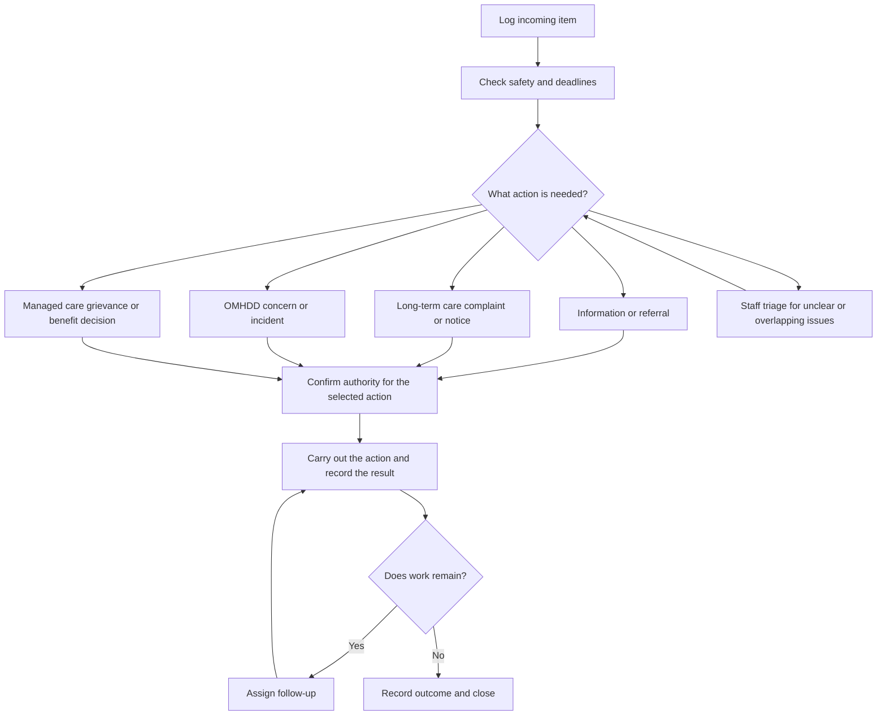

# Minnesota ombudsman workflows and automation opportunities

*Public-source research for Ombus, November 2026.*

The three offices share a pattern: receive a concern, identify who can help, gather facts, act within the office’s authority, and follow up. Ombus can support that work with shared intake, task tracking, and correspondence tools. Each office needs its own rules for jurisdiction, consent, deadlines, disclosure, and reporting.

## Offices and responsibilities

The Minnesota DHS Community-Based Services Manual links to several ombudsman offices. The third office in this map is the **Office of Ombudsperson for Public Managed Health Care Programs**, listed under State Managed Health Care Programs in the manual. The directory also covers other offices that may be referral destinations. [DHS ombudsman services directory](https://www.dhs.state.mn.us/main/idcplg?IdcService=GET_DYNAMIC_CONVERSION&RevisionSelectionMethod=LatestReleased&dDocName=id_000673)

| Office | Who and what it serves | Actions and authority |
| --- | --- | --- |
| **Office of Ombudsman for Long-Term Care (OOLTC)** | People needing or receiving long-term care, including nursing home and assisted living residents and recipients of home care. Issues include care, rights and choice, transfer, discharge, and termination. | Explain rights, support self-advocacy, visit facilities, review records under applicable authority, investigate, mediate, advocate, and recommend policy changes. The resident’s wishes guide complaint work. [Office overview](https://mn.gov/ooltc/), [OOLTC FAQ](https://mn.gov/ooltc/faqs/), [Minn. Stat. § 256.9742](https://www.revisor.mn.gov/statutes/cite/256.9742) |
| **Office of Ombudsman for Mental Health and Developmental Disabilities (OMHDD)** | People receiving services or treatment for mental illness, developmental disabilities, substance use disorders, or emotional disturbance. Concerns can come from anyone and may affect a person or a whole program. | Provide rights and access assistance, review guardian actions, mediate, investigate, examine records, visit programs, make recommendations, and monitor responses. Run Medical Review and the Civil Commitment Training and Resource Center. [OMHDD overview](https://mn.gov/omhdd/), [Client Services](https://mn.gov/omhdd/client-services/), [Minn. Stat. § 245.94](https://www.revisor.mn.gov/statutes/cite/245.94) |
| **Ombudsperson for Public Managed Health Care Programs** | Medical Assistance or MinnesotaCare enrollees in a managed health care plan. Issues include coverage, access, services, billing, grievances, and appeals. | Explain coverage and rights, contact plans, conduct informal review with the enrollee’s permission, and assist with plan grievances, plan appeals, and state fair hearings. The office also reviews external review requests, trains managed care advocates, and analyzes plan data. [DHS office overview](https://mn.gov/dhs/health-care/resources/resolve-problems-with-care/ombudsperson/), [Minn. Stat. § 256B.6903](https://www.revisor.mn.gov/statutes/cite/256B.6903) |

## Proposed action tree

1. **Log the incoming item.** Record the channel, receipt time, source document, reporter’s relationship to the person affected, safe contact method, accessibility needs, service setting or plan, the issue, and the outcome sought. Ask for additional identifiers only when the selected workflow needs them.
2. **Check for immediate danger and time-sensitive events.** Show emergency guidance when immediate danger is reported. Flag suspected maltreatment, serious injuries, deaths, imminent moves, and urgent treatment denials for staff review. Adult maltreatment reporting has its own destination, the Minnesota Adult Abuse Reporting Center (MAARC). Office staff determine whether and how they may disclose case details. [DHS reporting guidance](https://mn.gov/dhs/about-us/about-human-services/terms-rights-access/report-abuse/), [Federal long-term care complaint rules](https://www.ecfr.gov/current/title-45/subtitle-B/chapter-XIII/subchapter-C/part-1324/subpart-A/section-1324.19)
3. **Select a branch.** Use the issue and the entity whose action is at stake. Create one work item per actionable issue. Send ambiguous or overlapping matters to a staff triage queue. For example, an assisted living contract termination can call for OOLTC or OMHDD advocacy, while a separate plan denial in the same situation can call for managed care appeal assistance. Staff can link those tasks within their authorized workspace. [Minn. Stat. § 144G.52](https://www.revisor.mn.gov/statutes/2026/cite/144G.52), [Managed care office overview](https://mn.gov/dhs/health-care/resources/resolve-problems-with-care/ombudsperson/)
4. **Confirm authority and act.** Staff record the person’s wishes, applicable consent or other authority, and any limits on records access or disclosure. Assign an owner, identify the next step, and carry out the action below. Each external handoff records its destination, permitted data, sending status, and expected follow-up.
5. **Verify the outcome and follow up.** Record findings, any change made by the facility or plan, the person’s perspective when applicable, and outstanding commitments. Staff decide to close, schedule follow-up, or reopen. Recurring issues can generate a separate policy or quality review item.

| Branch and trigger | Staff action | Ombus support |
| --- | --- | --- |
| **Information, education, or referral**. Rights, coverage, civil commitment, training, or an out-of-scope issue. | Provide a resource, explain options, arrange training or accessible communication, or help the person connect with the appropriate office, plan, or county or Tribal advocate. [OOLTC](https://mn.gov/ooltc/), [Civil Commitment Training and Resource Center](https://mn.gov/omhdd/commitment/), [Managed care office](https://mn.gov/dhs/health-care/resources/resolve-problems-with-care/ombudsperson/) | Search approved resources, suggest a destination, and log the consultation or confirmed referral. |
| **OOLTC resident complaint**. Care, dignity, rights, choice, or another long-term care issue. | Speak privately with the resident when possible, establish their wishes and informed consent or applicable exception, develop a plan, investigate, mediate or advocate, and check whether the result satisfies the resident. Verify a representative’s authority when relying on it. [OOLTC FAQ](https://mn.gov/ooltc/faqs/), [45 CFR § 1324.19](https://www.ecfr.gov/current/title-45/subtitle-B/chapter-XIII/subchapter-C/part-1324/subpart-A/section-1324.19) | Capture consent by purpose, organize interviews and evidence, log facility visits, and track actions and resident feedback at the complaint level. |
| **OOLTC facility notice**. Assisted living or nursing facility notice. | Identify notice type, check completeness, assess timing, and determine whether to contact the resident, offer advocacy, or assist with a meeting or appeal. Track electronic-monitoring exception forms as a distinct submission type. [Provider notices](https://mn.gov/ooltc/providerresources/submittingnotices/), [Assisted living terminations](https://www.revisor.mn.gov/statutes/2026/cite/144G.52), [Electronic monitoring](https://mn.gov/ooltc/residentandfamilyresources/electronicmonitoring/) | Import from approved fax or email channels, extract dates with links to the original, match facility and region, and create a review task. Create a linked complaint if staff open one. |
| **OMHDD client or systemic concern**. Rights, services, guardian actions, or provider practice. | Assign to Client Services. Decide whether to consult, mediate, investigate, visit, or request records under applicable authority. Notify relevant licensing or regulatory officials before reviewing a facility or program action as required. Consider the response, make recommendations, and track follow-up. [Client Services](https://mn.gov/omhdd/client-services/), [Complaint intake](https://mn.gov/omhdd/client-services/how-to-file-a-complaint.jsp), [Minn. Stat. § 245.94](https://www.revisor.mn.gov/statutes/cite/245.94) | Suggest assignment by county, prepare records requests and notification drafts, and track findings, recommendations, and agency responses. |
| **OMHDD incident**. Death, serious injury, or a report of emergency manual restraint under § 245D.061. | Log and assess the incident on its applicable track. The Medical Review Coordinator uses guidelines to decide which reported deaths to prepare for subcommittee review. Refer matters requiring regulatory investigation when appropriate and track resulting recommendations. [Incident reporting](https://mn.gov/omhdd/reporting-death-or-serious-injury/), [Medical Review Subcommittee](https://mn.gov/omhdd/reporting-death-or-serious-injury/medical-review-subcommittee.jsp), [Minn. Stat. § 245D.061](https://www.revisor.mn.gov/statutes/cite/245D.061) | Link supplemental documents to the agency case number, flag missing items, and assemble a review packet for authorized staff. |
| **Managed care access, billing, or grievance**. A coverage question, navigation problem, or dissatisfaction with care, access, or treatment by the plan. | Confirm plan and program, check prior Member Services contact, explain grievance options, and assist with plan contact or informal review with permission. [DHS office overview](https://mn.gov/dhs/health-care/resources/resolve-problems-with-care/ombudsperson/), [Minn. Stat. § 256B.6903](https://www.revisor.mn.gov/statutes/cite/256B.6903) | Look up contacts, draft an inquiry, and track response and resolution. |
| **Managed care adverse benefit determination**. Denial, reduction, termination, or denial of payment. | Review the notice and help the enrollee determine the plan appeal, expedited appeal, continuation-of-benefits, or state fair hearing steps. Flag a missed plan deadline for human review of possible deemed exhaustion. The plan decides its appeal and the state decides the fair hearing. [DHS grievance and appeal guidance](https://mn.gov/dhs/health-care/resources/resolve-problems-with-care/), [42 CFR § 438.408](https://www.ecfr.gov/current/title-42/chapter-IV/subchapter-C/part-438/subpart-F/section-438.408) | Prefill a packet, track separate deadlines and filing confirmation, and preserve the plan decision and hearing outcome. |

## Rules to model first

| Rule | Trigger and handling |
| --- | --- |
| **Assisted living termination appeal** | Capture the resident’s receipt date and statutory ground. Minnesota Rule 4659.0210 specifies 30 calendar days from receipt for the nonpayment or contract-violation route and 15 for expedited termination. The notice effective date and OOLTC receipt date serve different purposes. Staff verify the category and the date before relying on the calculation. [Minn. R. 4659.0210](https://www.revisor.mn.gov/rules/4659.0210/), [Minn. Stat. § 144G.52](https://www.revisor.mn.gov/statutes/2026/cite/144G.52) |
| **OMHDD incident reporting** | A covered reporter must notify OMHDD within 24 hours of a client’s death or serious injury. The report clock starts at the incident, and the duty belongs to the reporter. The § 245D.061 restraint submission uses a different trigger, five working days after the expanded support team review. Preserve separate deadlines for any parallel reporting duties. [Minn. Stat. § 245.94, subd. 2a](https://www.revisor.mn.gov/statutes/cite/245.94), [Minn. Stat. § 245D.061, subd. 8](https://www.revisor.mn.gov/statutes/cite/245D.061) |
| **Managed care appeals and continued benefits** | DHS publishes 60 days from the plan action notice for the plan appeal and 120 days from the plan appeal decision notice for a state appeal on the ordinary path. Track continued benefits separately. The federal plan-stage timing uses the later of 10 calendar days from sending the action notice or the proposed effective date, subject to eligibility conditions. After an adverse plan appeal resolution, the federal continuation rule tracks 10 calendar days from sending the resolution notice to request both a hearing and continued benefits. [DHS appeal guidance](https://mn.gov/dhs/health-care/resources/resolve-problems-with-care/), [42 CFR § 438.402](https://www.ecfr.gov/current/title-42/chapter-IV/subchapter-C/part-438/subpart-F/section-438.402), [42 CFR § 438.420](https://www.ecfr.gov/current/title-42/chapter-IV/subchapter-C/part-438/subpart-F/section-438.420) |
| **Consent and disclosure** | Record separate authority for investigation, access to private records, and release to a named recipient. Capture who authorized each action, scope, method, date, and any withdrawal. Route uncertain capacity, representative authority, statutory exceptions, and proposed disclosures to authorized staff. Restrict access by office and role and log disclosures. [OOLTC office data](https://www.revisor.mn.gov/statutes/cite/256.9744), [Federal OOLTC office requirements](https://www.ecfr.gov/current/title-45/subtitle-B/chapter-XIII/subchapter-C/part-1324/subpart-A/section-1324.11), [OMHDD powers and data](https://www.revisor.mn.gov/statutes/cite/245.94), [Managed care informal review authority](https://www.revisor.mn.gov/statutes/cite/256B.6903) |

## Pilot and implementation priorities

**Start with assisted living termination notices at OOLTC.** Providers already send notices with a standard cover sheet, and the notice type and dates determine distinct next steps. Admission, transfer, and eviction accounted for 888 OOLTC complaints across facility types in FY 2025. That establishes the category’s workload relevance. The pilot would measure the volume of assisted living termination notices and the staff time spent processing them directly. [Submitting notices](https://mn.gov/ooltc/providerresources/submittingnotices/), [OOLTC FY 2025 annual report, p. 7](https://mn.gov/ooltc/assets/2025_OOTLC%20Annual_Report_tcm1168-740385.pdf#page=7)

1. **Import one notice queue.** Preserve the original with its receipt time. Extract facility, notice type, stated reason, and relevant dates. Flag duplicate candidates, missing cover sheets, and uncertain dates for staff. Assign the notice to the right region on receipt. Generate the appeal deadline after staff verify the notice type and the resident’s receipt date.
2. **Reuse the workflow for OMHDD incidents and managed care appeals.** Add separate report and appeal types, staff-approved templates, and reminders. Use existing receipt or case numbers for supplements and updates. Test against synthetic or de-identified examples, including duplicate faxes, missing dates, a representative with unclear authority, and an untimely plan response.
3. **Connect approved reporting systems after measuring the pilot.** Preserve the distinction between contacts, cases, complaints, notices, incidents, and outcomes. Map OOLTC records to ACL’s National Ombudsman Reporting System categories, OMHDD review findings to its biennial reporting, and managed care data to its plan reporting workflows. The managed care office already describes contact and appeal databases and a plan reporting application, so verify current tools and import or export options with staff. [ACL reporting resources](https://acl.gov/programs/Protecting-Rights-and-Preventing-Abuse/Long-term-Care-Ombudsman-Program), [OMHDD biennial reporting statute](https://www.revisor.mn.gov/statutes/cite/245.95), [Managed care 2024 annual report, pp. 2 and 6](https://edocs.dhs.state.mn.us/lfserver/Public/DHS-6507I-ENG)

For each tree branch, store the **trigger, required inputs, assigned role, authority or consent needed, deadline rule and version, next action, and possible outcomes**. Keep event, notice, receipt, effective, and filing dates in separate fields. Missing or conflicting dates create a review task. Staff confirm jurisdiction, exceptions, disclosures, findings, and closure. Measure handling time, time to assignment, corrections to extracted fields or routes, and missed deadlines against the office’s baseline. Confirm local procedures, escalation coverage, retention, and systems of record with each office before enabling live data or outbound messages.
